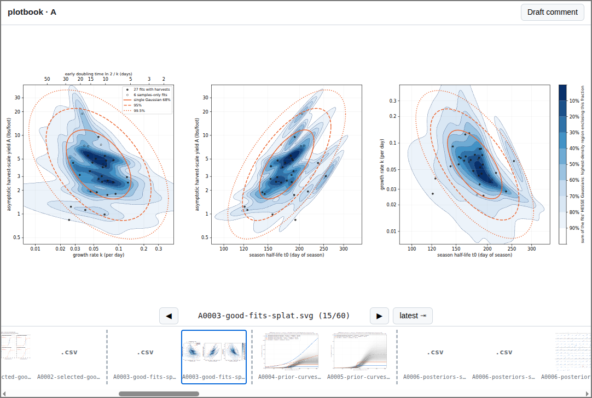
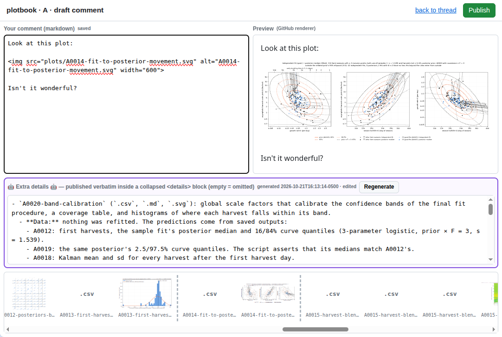

# plotbook

A Claude Code plugin that turns a GitHub PR thread into a scientific lab notebook for exploratory data analysis.

This tool functionally replaces Jupyter or marimo notebooks for data exploration in an era when we _describe the plots we want to see in words_. Instead of interleaving code and plots, this tool organizes Claude's output and lets you write the analysis narration as a GitHub PR thread with inline plots. The essential point is that you, the human, are still writing the GitHub comments and deciding which plots to show in the narrative, organizing Claude's deluge of output into a purpose-driven story.

## Overview

Here's how it works:
1. You create an empty directory and a git branch in your GitHub repo.
2. You start Claude Code in that directory.
3. `/plotbook:start A` to start a thread named `A`.
4. A plot viewer opens in a web browser.
5. You ask for plots and other output to analyze your data.
6. Those plots and the scripts that made them are named sequentially (`A0001`, `A0002`, etc.) and are browsable in the viewer.
7. When you reach some sort of conclusion, you draft a comment in the viewer, clicking on plots to add whichever ones are relevant to the conclusion. Pending commits are pushed to GitHub with the comment.
8. GOTO 5.
9. Open another Claude Code in another terminal and `/plotbook:start B` to ask for more plots in parallel (`B0001`, `B0002`, etc.). Its web viewer opens in another browser tab.

Your PR comment thread is a high-level view of the important turning points and the plots that support your conclusions.

Claude's detailed descriptions of how each plot was made are hidden inside of "🤖 Extra details 🤖" blocks that you can expand if necessary. The code that generated the plots and the full text of your Claude conversation are checked into git for later forensics, but not the high-level view. (If your repo is public, be careful what you say to Claude!)

The tool will recover if you manually push or add your own commits or comments. It doesn't try to be the only tool you use.

In the Claude Code conversation, you can refer to any plot by its prefix, such as `A0003`. This is useful when you want to ask for "a plot like A0003, but with the following changes..."

## How to install

```sh
claude plugin marketplace add dsi-rse/plotbook
claude plugin install plotbook@plotbook
```

**Dependencies:** Python with Matplotlib and anything else needed to make your plots, [git](https://git-scm.com/install/), [gh](https://cli.github.com/), and [uv](https://docs.astral.sh/uv/).

You don't have to give Claude git/GitHub permissions to use this tool. Even if you have

```yaml
"deny": ["Bash(git *)", "Bash(gh *)"]
```

in your `.claude/settings.json` (as I do), this plugin will work because the git/GitHub interactions are in the plugin's code, not invoked directly by Claude.

## Screenshots

Browsing recent plot images in one thread (`A`):



Drafting a GitHub comment (click to add plots and edit or copy from the "🤖 Extra details 🤖" block):



## File layout

Everything goes into the analysis directory that you created, with the following structure:

```
analysis-dir/
  plots/      outputs only: {thread}{NNNN}-{slug}.svg (and .geojson, …)
  scripts/    {thread}{NNNN}-{slug}.py plot scripts; shared_NNNN.py library deltas
  .plotbook/  transcripts/ (committed), published.jsonl, previews/, state/ (git-ignored)
```

Your Claude conversations are in `.plotbook/transcripts/`.

The primary format for the plots is SVG so that you can edit them (usually to remove unnecessary annotations or change labels). I recommend [Inkscape](https://inkscape.org/).

You can use code from other directories, but the plotting scripts in this directory are not intended for reuse. They're for reproducing the plots and remembering all the details of how they were made. Even the functions that are shared among multiple plots in this directory are versioned: `shared_NNNN.py` represents a tree of updates so that you can provisionally try a new technique and revert to build on an old version if you change your mind.

## More commands

* `/plotbook:start A` for some label like `A`, `B`, `C`: sets up the subdirectories and tells Claude to adhere to the filename convention.
* `/plotbook:push` starts a draft comment in the web viewer; equivalent to the green button in the web viewer.
* `/plotbook:repro A0003` reproduces a plot whose prefix is `A0003`.

Only `/plotbook:start` is required.

## Customizing

- Extra-details prompt: copy `templates/addendum-prompt.md` to `~/.config/plotbook/addendum-prompt.md` and edit it. `PLOTBOOK_ADDENDUM_MODEL` selects the model (default `sonnet`).
- Viewer by hand: `uv run --script <plugin>/server/viewer.py --root <analysis-dir>`.

## When something breaks

- `TRANSCRIPT-SYNC-BROKEN` appears in the analysis root: Claude Code changed its internal transcript format. Your files are still committed. Add the new entry type to the table at the top of `scripts/sync_transcript.py`. The next sync recovers the full transcript and removes the marker.
- "thread … is already claimed": another live session owns it. If that session crashed, use `/plotbook:start <thread> --steal`.

## Development

If you want to use plotbook while developing it, clone this repo and

```sh
claude --plugin-dir /path/to/plotbook
```

to install it only for that Claude Code session. After editing plotbook's code, do

```
/reload-plugins
! pkill -f "server/viewer.py --root"
! plotbook-viewer A
```

in Claude, where `A` is the letter of your thread.

You can also

```sh
claude plugin validate /path/to/plotbook
```

and

```sh
python3 -m pytest tests/
```

before submitting your improvements to the plugin.

PRs are welcome!
